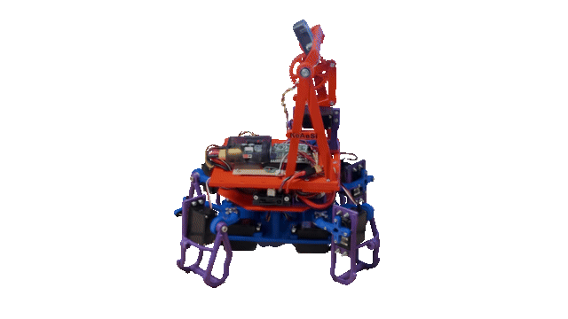

# KeAnSi Quadruped Robot



A quadruped robot made as a project for the [MMA4004 course](https://www.ntnu.edu/studies/courses/MMA4004) at NTNU. The task was to navigate an obstacle course with adjustable ramps and a corridor with multiple turns.

The project uses ESP32 controllers, a PC dashboard for control and testing, servo calibration tools, and MuJoCo for simulation.

## Setup

- Python 3.12+ with Tkinter
- Run commands from the repository root

```powershell
python -m venv .venv
.\.venv\Scripts\Activate.ps1
python -m pip install -r requirements.txt -r servo_calibration/requirements.txt
```

## Run

| Task | Command |
|---|---|
| Dashboard | `python dashboard/run.py` |
| Servo calibration | `python servo_calibration/gui.py` |
| Course simulation | `python robot.py walk --ramp --find-corridor` or `.\start.ps1` |
| Simulation options | `python robot.py walk --help` |
| Model checks | `python robot.py check b10` |

- Dashboard: http://127.0.0.1:8765
- Gait settings: `reference/b91_gait.toml` (dashboard and simulation)
- Generated reports and recordings: `results/` (ignored by Git)

## Calibration and firmware

1. Upload `servo_calibration/esp32_calibration/esp32_calibration.ino`.
2. Calibrate using the GUI. Measurements save to `servo_calibration/measurements.json`.
3. Export the header: `python servo_calibration/export_controller.py --output firmware/controller_esp32/measured_servos.h`.
4. Upload `firmware/controller_esp32/controller_esp32.ino` with its accompanying headers.

- Arduino libraries: Adafruit PWM Servo Driver and SparkFun BMI270
- Camera firmware: `firmware/timer_camera/`
- Wi-Fi: sketch `wifi_config.h` files configure connection to the PC's 2.4 GHz hotspot
- Yaw angles: -45 to +45 degrees
- Pitch angles: -90 to +45 degrees; +45 means foot down
- Stop: disables PWM; servo power remains on

## CAD and rebuild

- Current assembly and parts: `cad/B10_1/`
- Rebuild simulation: `python robot.py build`
- After STEP changes:
  1. `python -m pip install -r requirements-cad.txt`
  2. `python cad/export_b10_sim.py`
  3. `python robot.py build`
